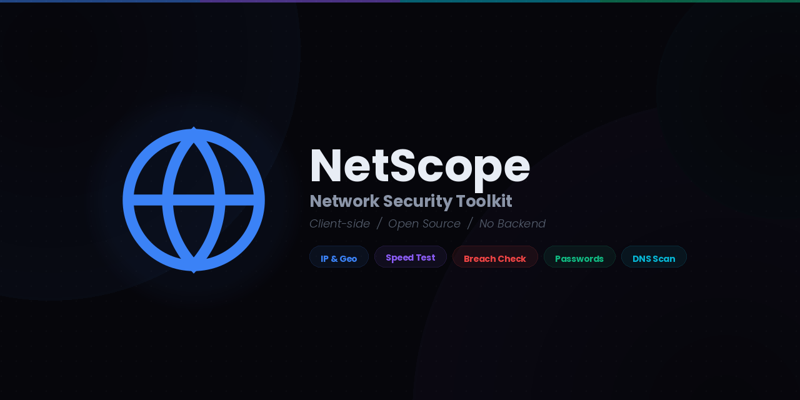

<p align="center">
  <a href="https://patrickking67.github.io/netscope/">
    
  </a>
</p>

<p align="center">
  <strong>An installable, client-side network security toolkit.</strong><br>
  Check your public IP and connection, test for breached credentials without giving them away, generate strong secrets, and grade a domain's DNS and email security. All from a static site with no backend.
</p>

<p align="center">
  <a href="https://github.com/patrickking67/netscope/actions/workflows/ci.yml"></a>
  <a href="LICENSE"></a>
</p>

<p align="center"><strong>Live:</strong> <a href="https://patrickking67.github.io/netscope/">patrickking67.github.io/netscope</a></p>

<p align="center">
  <a href="https://patrickking67.github.io/netscope/">
    
  </a>
</p>

---

## Why it exists

Most "check my connection" and "have I been breached" sites ask you to trust a server with exactly the data you are worried about. NetScope runs in your browser and talks only to the public APIs each check needs, sending the minimum each one requires. Passwords are hashed locally and only a 5-character hash prefix leaves the page.

It is plain HTML, CSS and JavaScript. The repository root is the deployed site: no framework, no bundler, no `node_modules`.

## Tools

The app (`pages/app.html`) has five tools plus a one-click Full Scan.

| Tool | What it checks | Service used |
| --- | --- | --- |
| **IP & Location** | Public IP, ISP, organization, ASN, IP version, proxy and hosting flags (when the provider reports them), approximate location on a map | ipify, seeip (IP); ipapi.co, ipwho.is, freeipapi.com (geolocation, tried in order); OpenStreetMap tiles |
| **Speed Test** | Ping and jitter (20 samples, outliers trimmed), then 12-second multi-connection download and upload with a 2-second warm-up. Every request has a deadline and the test can be cancelled; a stalled or cancelled run keeps the results measured so far | Cloudflare speed endpoints |
| **Breach Check: email** | Whether an address appears in known breaches, with the breach names | XposedOrNot |
| **Breach Check: password** | How many times a password appears in breach corpora, using k-anonymity | Have I Been Pwned Pwned Passwords |
| **Password Generator** | Random passwords, PINs, hex keys and 5-word passphrases, with strength computed from the generator's real entropy | None (Web Crypto) |
| **DNS & Security** | A, AAAA, MX and NS records (null MX recognized); SPF (missing, duplicate, `+all`, `?all`); DMARC policy and partial `pct=`; DKIM at 18 common selectors; DNSSEC validation; MTA-STS; SMTP TLS reporting; BIMI; WebRTC local address and VPN leak check; whether the page is on HTTPS. One overall verdict, and a plain-language explanation under each check | Google DNS-over-HTTPS; Google STUN |

**Full Scan** runs IP, speed, email breach (if an address is entered or you are signed in) and DNS (if a domain is entered) in sequence. Results, including the scan verdict and the email breach result, can be copied, emailed, or downloaded as a PDF (jsPDF). A password check adds only whether the password was found in a breach and an estimated strength score from 1 to 5; the password, its hash and the breach count are never exported. Optional sign-in (Google, GitHub or email via Firebase) adds cloud save of results and theme sync. Every tool works without an account.

## Privacy model

What each check sends, and to whom:

| Check | Leaves your browser | Never leaves your browser |
| --- | --- | --- |
| Password breach | The first 5 hex characters of the SHA-1 hash, sent to `api.pwnedpasswords.com/range/{prefix}` with `Add-Padding: true` so the response size does not hint at the result | The password, the full hash, the 35-character suffix used for matching |
| Email breach | The email address, sent to XposedOrNot (that is how their lookup works) | Nothing is stored by NetScope |
| IP & Location | Your IP reaches each provider as part of the request; the geolocation providers also receive it in the URL | |
| DNS scan | The domain name, sent to `dns.google` | |
| WebRTC check | A STUN request to `stun.l.google.com` | Local candidates are inspected in the page and only shown to you |
| Speed test | Random test payloads to and from Cloudflare | |
| Password generator | Nothing | Everything |

Other guarantees, each backed by code and tests:

- **Failed lookups are never reported as safe.** A rate-limited or failed breach lookup shows an error, not "no breaches found". A DNS lookup that fails says "could not look up", and a domain that does not exist says so instead of being graded.
- **Nothing hangs forever.** IP, breach and DNS requests time out after 10 seconds and show an error.
- **No telemetry.** No analytics, tracking pixels or third-party cookies.
- **Strict Content-Security-Policy.** Every page forbids inline scripts, `eval`, plugins and `<base>` changes, and the app page lists the exact API hosts it may contact. Leaflet and jsPDF are pinned with Subresource Integrity hashes.
- **The service worker never caches API responses.** It only stores same-origin files inside its own scope, so breach, IP and DNS results are never written to disk by the PWA.
- **Cloud save is opt-in.** If you sign in and press Save, the results (IP, city, country, ISP and coordinates, speed, scanned domain and checks, and the checked email address with its breach count) are written to `users/{uid}/results` in Firestore. Passwords are never saved or exported. The Firebase SDK is loaded from Google's CDN on the app page even for guests.

See [SECURITY.md](SECURITY.md) to report a vulnerability.

## Run it locally

No install step. You need Python 3, and Node.js 22 or newer for the checks.

```bash
git clone https://github.com/patrickking67/netscope.git
cd netscope
npm run serve        # python3 -m http.server 4102 --directory .
# open http://localhost:4102
```

The same server is defined in `.claude/launch.json` for the Claude desktop preview.

Serve over HTTP rather than opening `index.html` from disk. Service workers and some browser APIs do not work on `file://` URLs.

## Install as an app (PWA)

NetScope ships a web app manifest and a service worker that caches the app shell.

- **Chrome or Edge (desktop):** open the [live site](https://patrickking67.github.io/netscope/pages/app.html) and use the install icon in the address bar or the browser menu's install option.
- **Android (Chrome):** menu, then **Add to Home screen** or **Install app**.
- **iOS and iPadOS (Safari):** Share, then **Add to Home Screen**.
- **macOS (Safari 17+):** File, then **Add to Dock**.

Once installed, the interface opens offline. The checks themselves need a network connection.

## Tests

Unit tests use Node's built-in test runner. No dependencies to install; Node 22 or newer.

```bash
npm run check         # everything below, in one command
npm test              # 96 unit tests
npm run check:static  # asset links, JS syntax, PWA files, required docs, llms.txt, launch.json, no em dashes or emoji
```

What is covered:

- **k-anonymity:** with a recording `fetch`, asserts only the 5-character prefix is sent and the password, full hash and suffix never appear in the request; HTTP errors throw instead of returning zero.
- **Password report:** the export shows breach found or not and a strength score, and never the password, its full hash, the hash prefix or the breach count, even if extra fields end up in state.
- **Breach parsing:** both XposedOrNot response shapes, 404 as clean, 429 and 5xx as errors, the network fallback.
- **DNS grading:** domain input normalization, quoted TXT joining, SPF and DMARC edge cases (including `sp=` not being mistaken for `p=` and partial `pct=`), revoked DKIM keys, MTA-STS, TLS-RPT, BIMI, null MX, and `scanDomain` against a fake resolver for NXDOMAIN, total failure and single failed lookups.
- **Timeouts:** `fetchWithTimeout` aborts a request that never answers and leaves ordinary errors alone.
- **WebRTC:** candidate parsing, private ranges, and not flagging the normal STUN public address as a leak.
- **Generator:** rejection sampling (no modulo bias), entropy from pool size or word list size.
- **Speed math:** latency trimming and time-ordered jitter, throughput after warm-up.
- **Speed timing:** with a fake clock and fake transfers, a stalled phase ends at its hard deadline, a cancel stops at once, completed transfers survive as a partial result, and lost pings are skipped.
- **Service worker:** loaded in a `vm` sandbox to check scope limits, error responses not cached, offline fallback, stale-while-revalidate, and that every page script is in the app shell.
- **Pages:** CSP present and strict on every page, no inline scripts or handlers, SRI on CDN scripts, every API host the code calls is in `connect-src`, skip link and `<main>` on every page, ARIA tabs, live result regions, named icon buttons, and no untimed third-party `fetch`.

CI runs `npm run check` on every push and pull request ([`.github/workflows/ci.yml`](.github/workflows/ci.yml)).

## Project layout

```
index.html                  Landing page
pages/app.html              The toolkit
pages/about.html            About and privacy summary
assets/js/core.js           Pure logic: hashing, parsing, grading, entropy, speed math (unit tested)
assets/js/app.js            DOM wiring, network calls, rendering
assets/js/auth.js           Optional Firebase sign-in and saved-results panel
assets/js/firestore.js      Optional cloud save and preferences
assets/js/firebase-config.js  Public Firebase web config
assets/js/theme-init.js     Applies the saved theme before first paint
assets/js/site.js           Landing and about page interactions
assets/js/pwa.js            Service worker registration
sw.js                       Service worker (app shell cache)
manifest.webmanifest        PWA manifest
tests/                      node:test suites
scripts/check-static-site.py  Static validation used in CI and deploy
docs/                       Architecture notes and Firebase setup
llms.txt                    Summary for language models, served at /netscope/llms.txt
.claude/launch.json         Local preview config (port 4102)
```

See [AGENTS.md](AGENTS.md) for the agent guide and [CONTRIBUTING.md](CONTRIBUTING.md) for branch and commit conventions. Changes are listed in [CHANGELOG.md](CHANGELOG.md).

`core.js` is a classic script that also exports through `module.exports`, so the browser loads it with a normal `<script>` tag and Node tests `require()` it without a build step.

## Deployment

Pushes to `main` deploy to GitHub Pages through [`.github/workflows/static.yml`](.github/workflows/static.yml), which runs the static checks first. To deploy a fork, set **Settings > Pages > Source** to **GitHub Actions** and push to `main`.

Firebase is optional. To use your own project, follow [docs/FIREBASE_SETUP.md](docs/FIREBASE_SETUP.md), then update the `frame-src` host in the CSP in `pages/app.html` to your `authDomain`.

## Credits

- [Have I Been Pwned](https://haveibeenpwned.com) for the Pwned Passwords range API.
- [XposedOrNot](https://xposedornot.com) for the free email breach API.
- [Ookla Speedtest](https://www.speedtest.net) inspired the multi-connection test and gauge.

## License

[MIT](LICENSE). Copyright (c) 2026 Patrick King.
