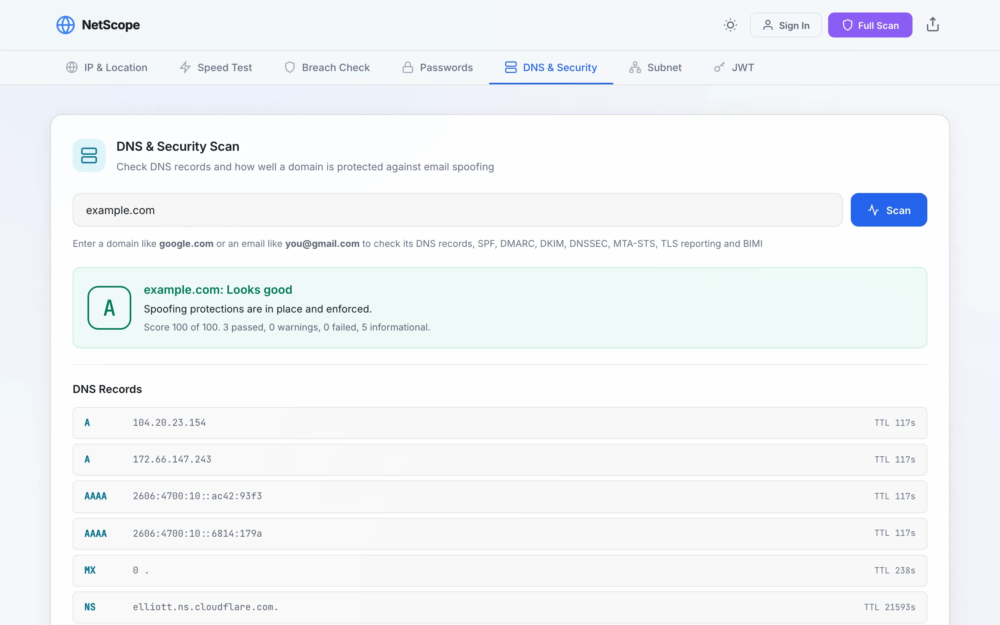
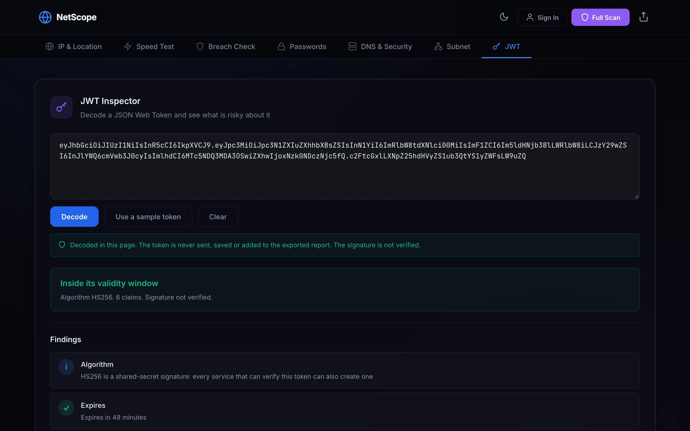
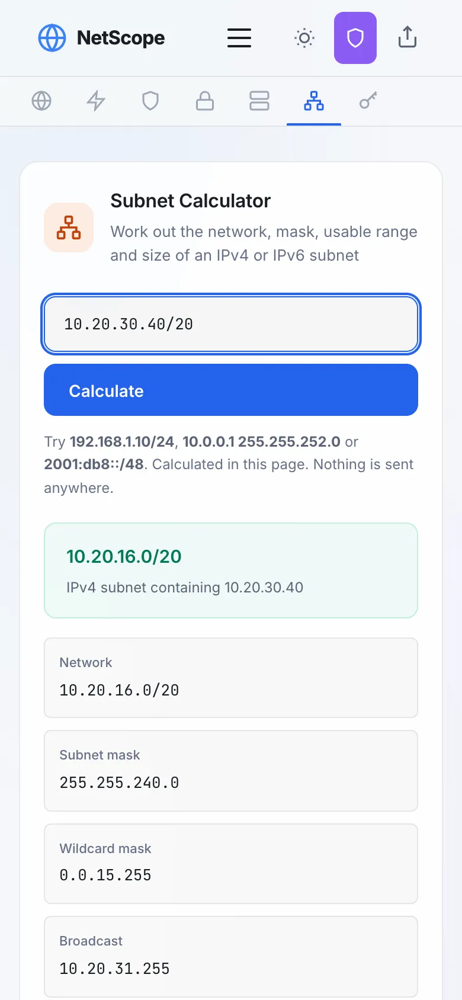
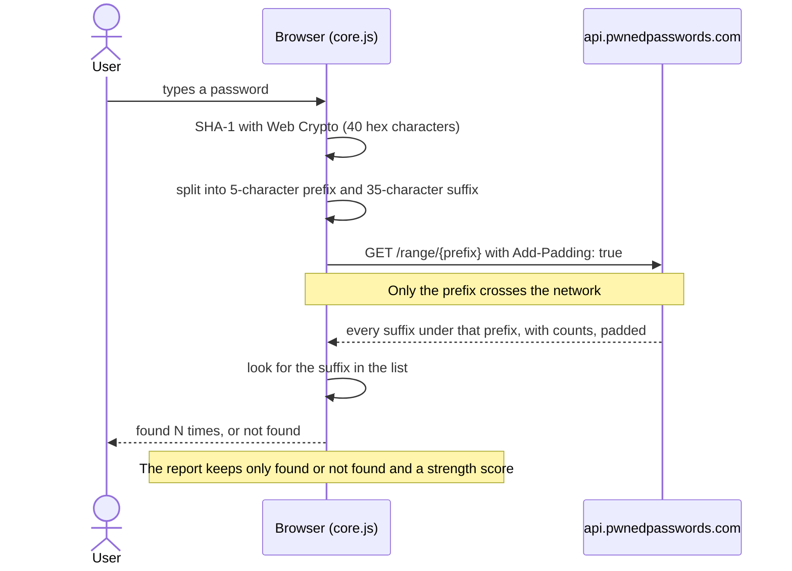
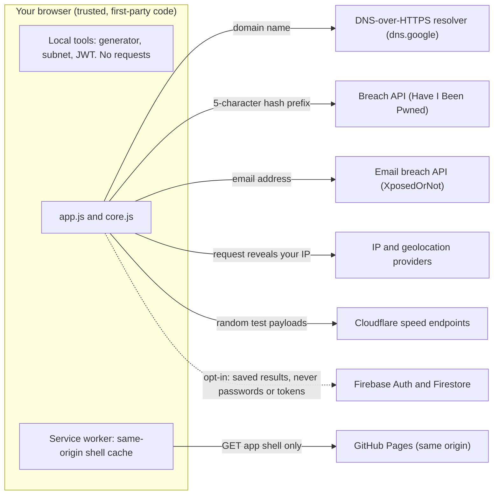

<p align="center">
  <a href="https://patrickking67.github.io/netscope/">
    <picture>
      <source media="(prefers-color-scheme: dark)" srcset="assets/images/logo-dark.svg">
      
    </picture>
  </a>
</p>

<p align="center">
  A network security toolkit that runs entirely in the browser: seven tools on a static site with no backend, built so that secrets you type never reach a server.
</p>

<p align="center">
  <a href="https://github.com/patrickking67/netscope/actions/workflows/ci.yml"></a>
  <a href="LICENSE"></a>
  <a href="tests/"></a>
  <a href="https://patrickking67.github.io/netscope/"></a>
</p>

<p align="center">
  <a href="https://patrickking67.github.io/netscope/pages/app.html">
    <picture>
      <source media="(prefers-color-scheme: dark)" srcset="docs/assets/app-scan-dark.webp">
      
    </picture>
  </a>
</p>

## Try it

**Live:** [patrickking67.github.io/netscope](https://patrickking67.github.io/netscope/) (choose "Continue as guest"; every tool works without an account).

```bash
git clone https://github.com/patrickking67/netscope.git
cd netscope
npm run check   # static checks, text lint and 138 unit tests. Nothing to install.
npm run serve   # http://localhost:4102
```

You need Python 3 and Node.js 22 or newer. There is no install step and no build step.

## The tools

| Tool | What it does | Where data goes |
| --- | --- | --- |
| IP and location | Public IP, ISP, ASN, proxy and hosting flags, map | ipify or seeip, then ipapi.co, ipwho.is or freeipapi.com (tried in order); OpenStreetMap tiles |
| Speed test | Ping, jitter, multi-connection download and upload, with deadlines and a cancel button | Cloudflare speed endpoints |
| Breach check | Email breach lookup; password lookup with k-anonymity | XposedOrNot (email); Have I Been Pwned (5-character hash prefix only) |
| Password generator | Passwords, PINs, hex keys and passphrases with real entropy figures | Nowhere (Web Crypto) |
| DNS and email security | SPF, DMARC, DKIM, DNSSEC, MTA-STS, TLS-RPT, BIMI, graded A to F with a fix for each problem | Google DNS-over-HTTPS; a STUN request for the WebRTC leak check |
| Subnet calculator | Network, mask, usable range and size for IPv4 and IPv6 | Nowhere |
| JWT inspector | Decodes a token and flags `alg: none`, missing expiry, key hints and more | Nowhere. The token is never stored or exported |

Full Scan runs the network tools in sequence. Results export as text, email or PDF. Optional sign-in (Firebase) adds cloud save.

<p align="center">
  
  
</p>

## What is technically interesting here

- **The password never leaves the page, and a test proves it.** The password is hashed with SHA-1 locally and only the first 5 of 40 hex characters are sent. A recording `fetch` asserts that the password, the full hash and the suffix appear nowhere in the request. Code: [`checkPwnedPassword`](assets/js/core.js#L78). Test: [`tests/core.test.js`](tests/core.test.js#L100).
- **Network logic is pure and takes `fetch` as an argument.** [`core.js`](assets/js/core.js) has no DOM access and is loaded by the browser with a plain `<script>` and by Node with `require()`, so there is no build step and no mocking library. The domain scan runs against a fake resolver in tests: [`scanDomain`](assets/js/core.js#L429).
- **A failed lookup is never reported as a clean result.** Rate limits, timeouts and DNS errors surface as errors, a domain that does not exist is not graded, and a check that could not be looked up marks the grade incomplete instead of lowering it. Code: [`gradeChecks`](assets/js/core.js#L408). Tests: [scan failure cases](tests/core.test.js#L790).
- **The Content-Security-Policy is enforced by tests.** No page allows inline script or `eval`. A test extracts every `https://` origin the code calls and fails if one is missing from `connect-src`; another fails on any third-party script without an SRI hash. Tests: [`tests/pages.test.js`](tests/pages.test.js).
- **The speed test cannot hang.** Each phase has a hard deadline built on `AbortController`, a cancel signal chained to it, and partial results that survive a stall. Tested with a fake clock and fake transfers. Code: [`createDeadline`](assets/js/core.js#L761), [`runTransferPhase`](assets/js/core.js#L848). Tests: [stall and cancel cases](tests/core.test.js#L536).
- **The service worker never caches an API response.** It handles only same-origin GET requests inside its own scope, so breach, IP and DNS results are never written to disk. It is loaded in a `vm` sandbox and tested: [`sw.js`](sw.js#L31), [`tests/service-worker.test.js`](tests/service-worker.test.js).

## Architecture

The k-anonymity exchange for a password check:



Trust boundaries. Everything inside the browser box is first-party code served from GitHub Pages. Each arrow that leaves it is labeled with the data that crosses.



More diagrams (components, the domain scan pipeline, the service worker decision) are in [docs/architecture.md](docs/architecture.md).

## Quality signals

| Signal | Current state |
| --- | --- |
| Unit tests | 138 unit tests on Node's built-in runner, no test dependencies |
| Coverage of `core.js` | 99% of lines, 89% of branches (`npm run coverage`). `app.js` is DOM wiring and is checked in a browser, not unit tested |
| CI | `npm run check` on every push and pull request, Ubuntu, Node 24, read-only token ([ci.yml](.github/workflows/ci.yml)) |
| Security checks | Tests for CSP on all 3 pages, no inline script or handlers, SRI on CDN scripts, `connect-src` allowlist, no third-party request without a timeout |
| Accessibility checks | Tests for skip link and `<main>` on every page, ARIA tabs, live result regions and names on icon-only controls. Contrast, focus rings and 375px layout were checked by hand |
| Docs lint | The check fails if a documented test count is stale, a local asset link is broken, or committed text contains an em dash or emoji |
| Dependencies | 0 npm packages. Leaflet, jsPDF and the Firebase SDK load from CDNs at runtime |

## Privacy model

- Passwords: only the 5-character SHA-1 prefix is sent. The password, hash and breach count are never stored or exported.
- JWTs: decoded in the page. The token and its claims are never sent, stored or exported; the report keeps the algorithm, status and finding names.
- Email breach checks send the address to XposedOrNot, because that is how the lookup works.
- No analytics, tracking pixels or third-party cookies.
- Cloud save is opt-in and writes only the listed result fields to `users/{uid}/results` in Firestore.

The per-check detail and the vulnerability reporting process are in [SECURITY.md](SECURITY.md).

## Project layout

```
index.html, pages/app.html, pages/about.html   The three pages, each with its own CSP
assets/js/core.js        Pure logic: hashing, parsing, grading, subnet math, JWT decoding, speed math
assets/js/app.js         DOM wiring, network calls, rendering
assets/js/auth.js, firestore.js, firebase-config.js   Optional sign-in and cloud save
sw.js, manifest.webmanifest   PWA shell cache and manifest
tests/                   core, pages and service worker suites
scripts/check-static-site.py   Static validation and docs lint
docs/                    Architecture notes, screenshots, Firebase setup
```

## Checks

```bash
npm run check         # everything: static check, docs and text lint, unit tests
npm test              # unit tests only
npm run coverage      # unit tests with a coverage report for core.js
```

## Deploy

Pushes to `main` deploy to GitHub Pages through [static.yml](.github/workflows/static.yml), which runs the static check first. The repository root is the published site. To deploy a fork, set Pages to "GitHub Actions" and push. Firebase is optional: see [docs/FIREBASE_SETUP.md](docs/FIREBASE_SETUP.md).

NetScope installs as an app from the browser's install prompt. The interface and the three local tools work offline; the network tools need a connection.

## More

- [AGENTS.md](AGENTS.md): commands, layout and rules for coding agents
- [CONTRIBUTING.md](CONTRIBUTING.md): branch names, commit style and the PR checklist
- [SECURITY.md](SECURITY.md): security model and private reporting
- [CHANGELOG.md](CHANGELOG.md): what changed and when

Credits: [Have I Been Pwned](https://haveibeenpwned.com) for the range API, [XposedOrNot](https://xposedornot.com) for the email breach API.

## License

[MIT](LICENSE). Copyright (c) 2026 Patrick King.
