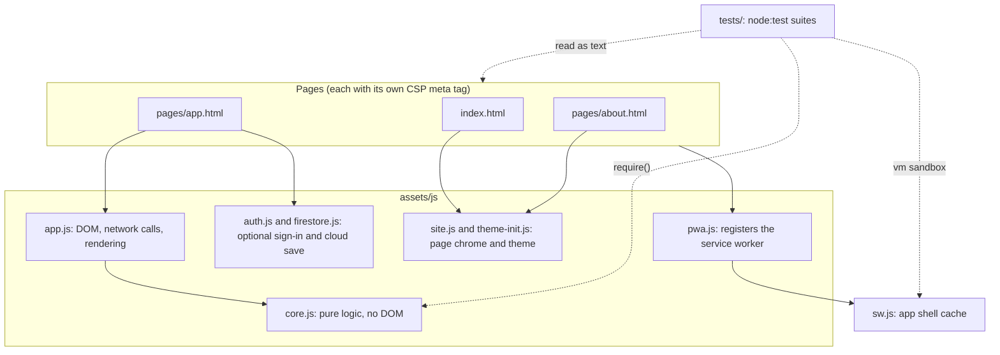
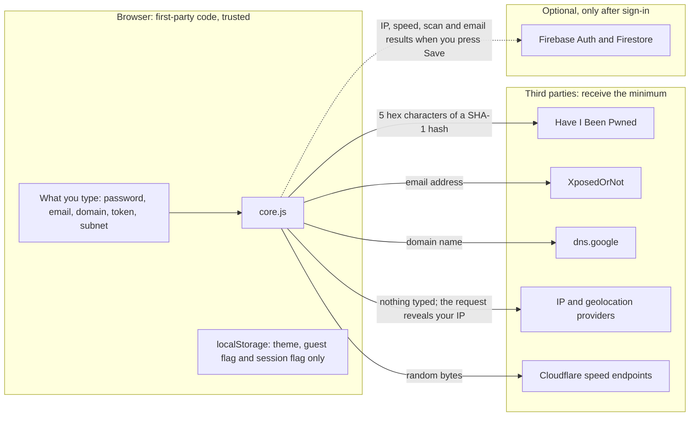
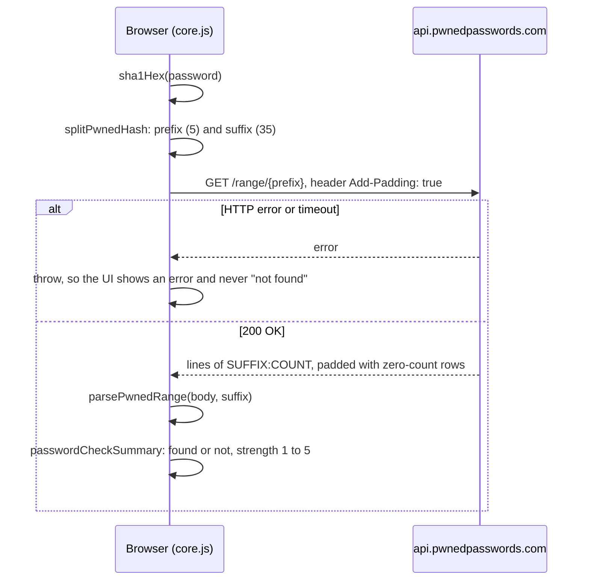
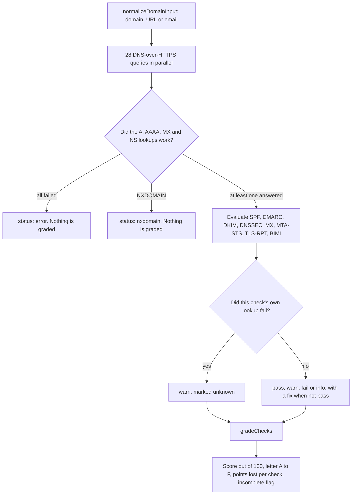
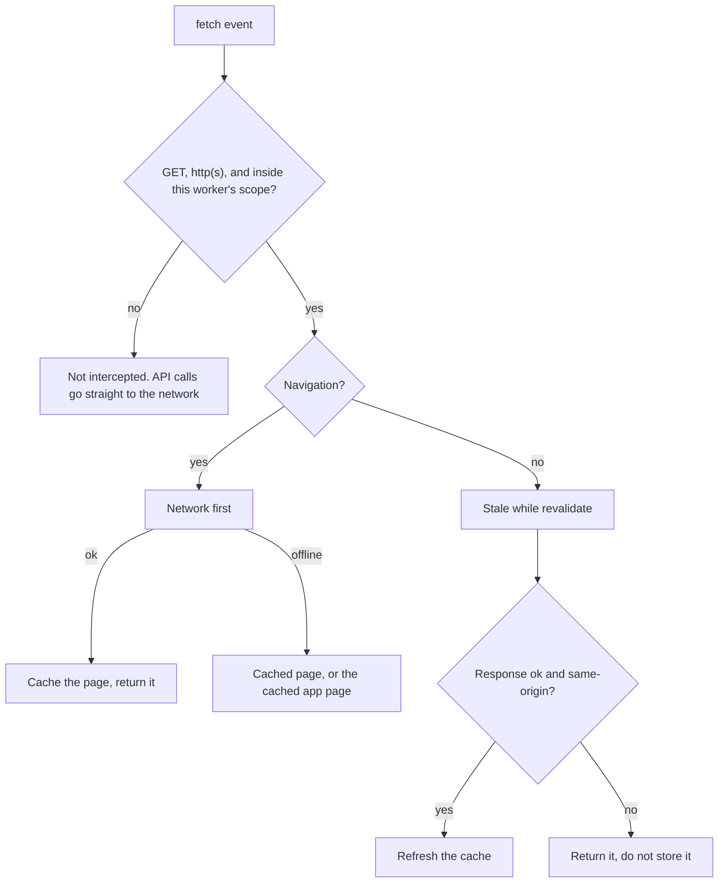

# Architecture

NetScope is a static web application with no build step and no backend. The repository root is the published GitHub Pages site. All logic runs in the browser; the only servers involved are GitHub Pages (for the files) and the public APIs each tool calls directly.

## Components

What to notice: `core.js` is the only place with real logic, and it has no DOM access. It is a classic script that also sets `module.exports`, so the browser loads it with a `<script>` tag and the tests load the same file with `require()`. Anything in it that talks to the network takes `fetch` (or a DNS-over-HTTPS function) as an argument, which is what lets the tests record exactly what would leave the browser.

## Trust boundaries

What to notice: a password, a JWT and a subnet never cross the browser boundary in any form except the 5-character hash prefix. The app page's `connect-src` lists exactly these hosts, and `tests/pages.test.js` fails if the code calls a host that is not listed. Firebase is the only place results are stored, and only when a signed-in user presses Save; `firestore.js` picks named fields and has no password or token field to pick.

## The k-anonymity password check

What to notice: `buildPwnedRangeUrl` throws on anything that is not exactly five uppercase hex characters, so a coding mistake cannot send a full hash. The error branch matters as much as the happy path: a failed lookup throws instead of returning zero, so a rate limit is never shown as a safe password. The summary that reaches the report holds a boolean and a score, not the breach count, because a count can identify a common password.

## The domain scan and grade

What to notice: the scan separates "the record is missing" from "the lookup failed". A missing SPF record costs 30 points; an SPF lookup that timed out costs nothing and sets `incomplete`. The 28 queries are 4 record types, 6 policy records and 18 common DKIM selectors, all settled with `Promise.all` so one slow answer does not hold up the rest. Optional controls (MTA-STS, TLS-RPT, BIMI, an undiscovered DKIM selector) report as info and never lower the grade.

## The service worker

What to notice: the first decision is the privacy property. Breach, IP, DNS and speed requests are third-party, so they fail the scope check and are never cached. GitHub Pages serves every project of an account from one origin, which is why the check is the worker's scope and not just the origin. Error pages are not stored, so a bad deploy cannot poison the cache.

## Local tools

The password generator, subnet calculator and JWT inspector make no network request. The subnet calculator uses plain numbers for IPv4 and `BigInt` for IPv6, and prints IPv6 in RFC 5952 form. The JWT inspector decodes base64url with a fatal UTF-8 decoder, never verifies the signature (it says so in every result), and hands the report only an algorithm name, a status and finding names through `jwtReportSummary`.

## Rules that follow from this design

- New logic goes in `core.js` with a test. `app.js` renders.
- A new API host must be added to `connect-src` in `pages/app.html` on purpose. The tests fail otherwise.
- Changing a file in the app shell means bumping `CACHE_NAME` in `sw.js`.
- Untrusted data (API responses, token claims, DNS records) is rendered with `escapeHtml` or `textContent`.
